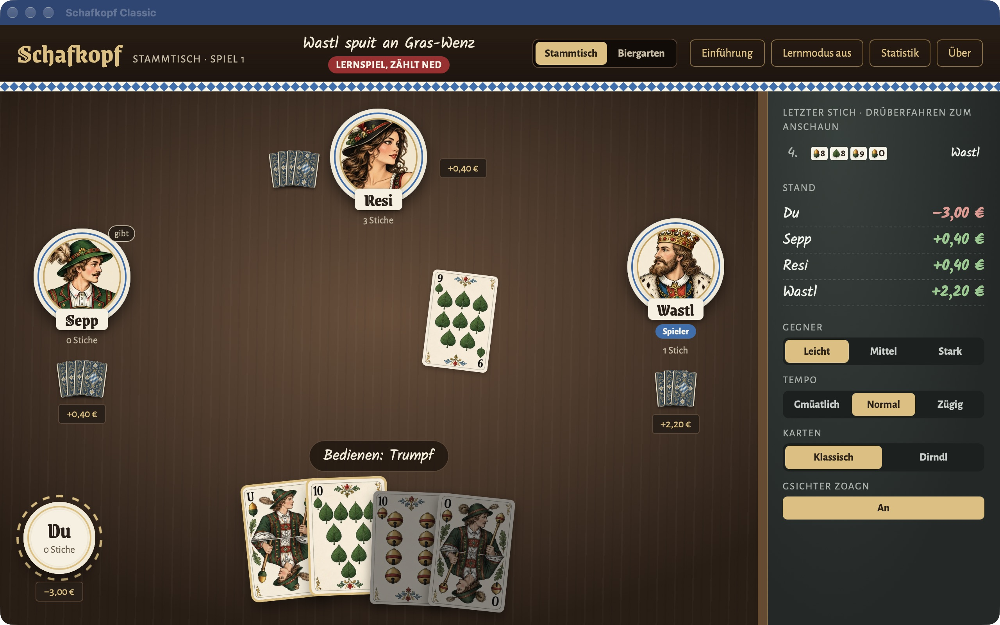
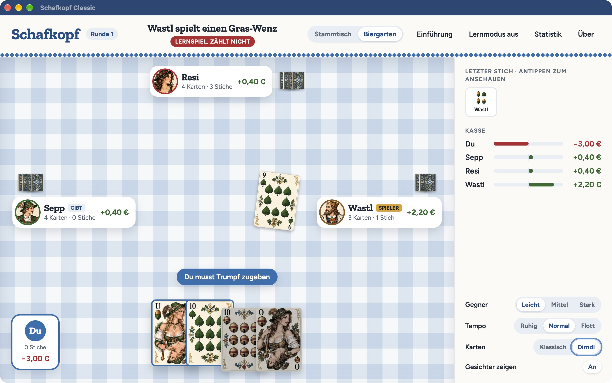
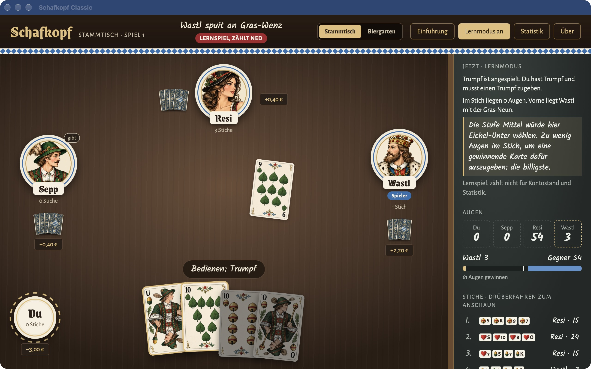

# Schafkopf Classic

Eine Runde Schafkopf – wann immer du Lust hast. Spiele bayerischen Schafkopf
gegen Sepp, Resi und Wastl: mit drei KI-Stufen, Lernmodus und zwei Tischgestaltungen.
Kostenlos für private Nutzung, auf Windows und macOS. Das Spiel läuft offline.

**[Jetzt herunterladen](https://github.com/j3ffwin5tonone/Schafkopf-Releases/releases/latest)**

### Dein Tisch, dein Spiel

Am **Stammtisch** spielst du in dunkler Holzoptik und mit bayerischen Texten.
Der helle **Biergarten** bringt eine zweite Gestaltung und hochdeutsche Texte mit.
Zwei Kartensätze stehen zur Auswahl.

### Mitspielen und dazulernen

Der **Lernmodus** erklärt die Spielsituation und die Entscheidungen der Computer.
Auf Wunsch bekommst du einen Zugvorschlag – hilfreich beim Einstieg und zum Üben.
Lernpartien fließen nicht in deine Konten und Statistik ein.

Dein Spielstand wird automatisch gespeichert. Beim nächsten Start kannst du die
Runde fortsetzen. Wähle zwischen **Leicht**, **Mittel** und **Stark**, je nachdem,
wie viel Herausforderung du suchst.

## Herunterladen und losspielen

**[Zur aktuellen Version für Windows und macOS](https://github.com/j3ffwin5tonone/Schafkopf-Releases/releases/latest)**

### Windows x64

Wähle entweder den **EXE-Installer** oder den **MSI-Installer**. Du brauchst nur
einen davon. WebView2 wird bei Bedarf während der Installation heruntergeladen.
Die Installer sind derzeit nicht mit einem Windows-Code-Signing-Zertifikat
signiert. Windows SmartScreen kann deshalb eine Warnung anzeigen.

### macOS — Apple Silicon und Intel

Lade das **Universal-ZIP** herunter, entpacke es und ziehe **Schafkopf Classic.app**
in den Ordner **Programme**. Die App enthält beide Prozessorarchitekturen und
ist mit Developer ID signiert und von Apple notarisiert.

### Programm-Updates

Direktdownload-Versionen können beim Start und manuell unter **Programm-Updates**
nach Aktualisierungen suchen. Die automatische Prüfung ist abschaltbar. Download
und Installation starten nach deiner Zustimmung; dein Spielstand wird vorher
gespeichert. Details zu den Verbindungsdaten stehen in der
[Datenschutzerklärung](https://schafkopf-classic.de/schafkopf/datenschutz/).

Bestehende Installationen von **0.1.0** benötigen einmalig eine manuelle
Installation der aktuellen Version, da sie noch keinen Updater enthalten.

Das Kartenspiel funktioniert weiterhin offline. Linux-Updates über diesen Kanal
werden derzeit nicht angeboten.

## Prüfungen

Vor der Veröffentlichung werden automatisierte Tests, Prüfungen der
Abhängigkeiten ausgeführt. Die Windows-Installer wurden zusätzlich mit
Microsoft Defender geprüft. Zum Download gehören
`SHA256SUMS*.txt` mit den Prüfsummen. `defender-scan.txt` dokumentiert den
Windows-Virenscan; `build-macos-universal.json` die macOS-Buildprüfungen.
Der echte Windows-Update-Test von 0.2.0 auf 0.2.1 wurde bestätigt: Der Spielstand blieb erhalten und es gab kein erneutes Update-Angebot. Auch der entsprechende Mac-Update-Test war erfolgreich.

## Lizenz

Kostenlos für private, nicht gewerbliche Nutzung. Es gelten die
[Lizenzbedingungen](LIZENZ.txt). Hinweise zu enthaltenen Bibliotheken stehen in
[LIZENZEN-DRITTER.txt](LIZENZEN-DRITTER.txt) und in der App.

Dieses Repository enthält Downloads, Screenshots, Nutzungshinweise und
Lizenztexte. Die automatisch von GitHub angebotenen „Source code“-Archive
enthalten diese öffentlich sichtbaren Dateien, nicht den Quellcode des Spiels.
